

# Curveon

**Motorcycle navigation that loves curvy roads — and works without a signal.**

Curveon turns your phone, or an Android tablet on the handlebars, into a dashboard for the ride:
maps, turn-by-turn navigation, your music, messages and calls, all in one place.
Free, open source and made for riders.

 

Android 10 or newer · phone or tablet · English and Norwegian

 

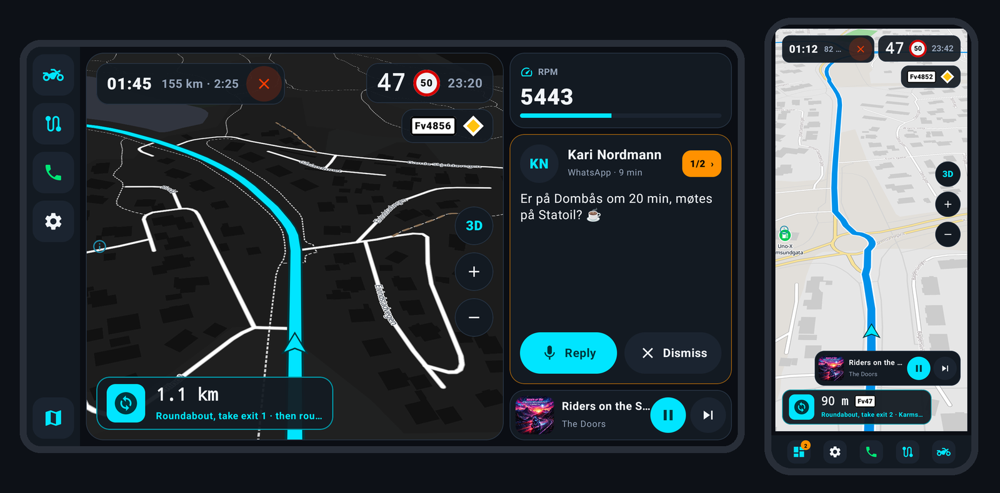

---

## Why Curveon?

- 🏍️ **Finds the fun roads.** Choose *Fastest*, *Curvy* or *Super curvy* and see all three side by
  side before you go: time, distance and how twisty each one is.
- 📴 **Works offline.** Download the countries you ride in once. Maps, routes and search then work
  in the mountains, in tunnels and abroad, with no mobile data.
- 🎵 **Everything on one screen.** Music, messages and calls from your phone show up next to the
  map, with big buttons you can hit with gloves on.
- 🗺️ **Plan your way.** Drag the route where you want it, draw a roundtrip with one finger, keep
  trips for later, and ride any GPX track.

---

## A quick tour

### Pick your kind of ride

Search for a place (towns, addresses, fuel, cafés, viewpoints, campsites, ferries and more, all
offline), and Curveon shows three routes at once. Choose *Tarmac only*, skip ferries or motorways,
and the choices update in place.

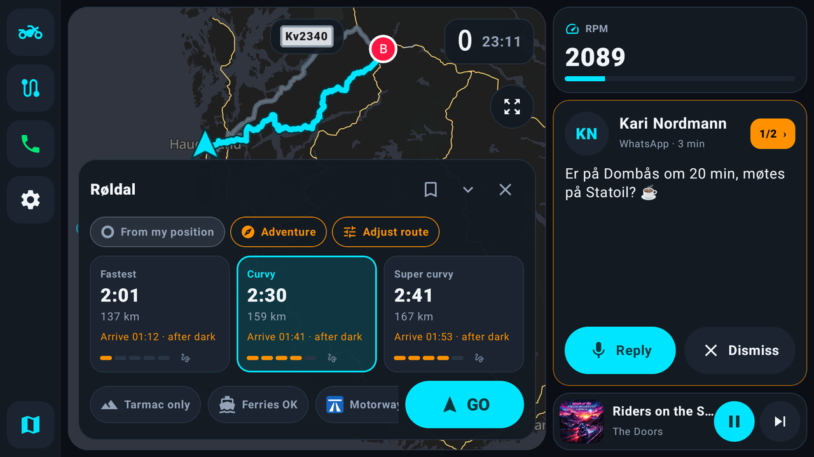

### On the road

A big turn card with road numbers, your speed next to the speed limit, the road you are on, and
warnings for speed cameras. Your music, the latest message (reply by voice through your headset)
and, if you like, engine data such as revs sit beside the map.

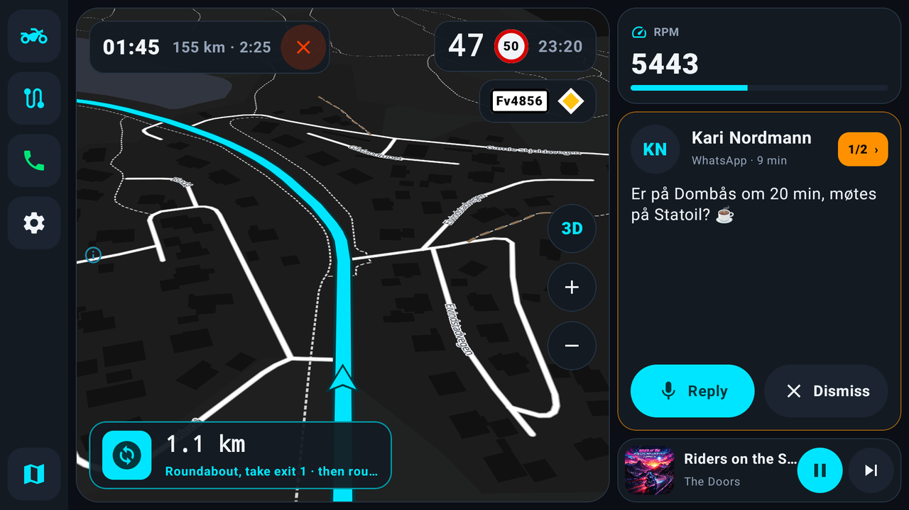

Prefer just the map? One tap gives you the full-screen map, here in day colours. Day and night
colours can also switch by themselves, following the sun where you are.

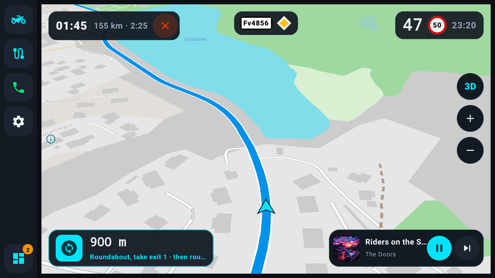

### Calls without fumbling

When someone rings, a big card with *Answer* and *Decline* covers the screen. Once you answer,
it shrinks to a small phone icon you can drag out of the way.

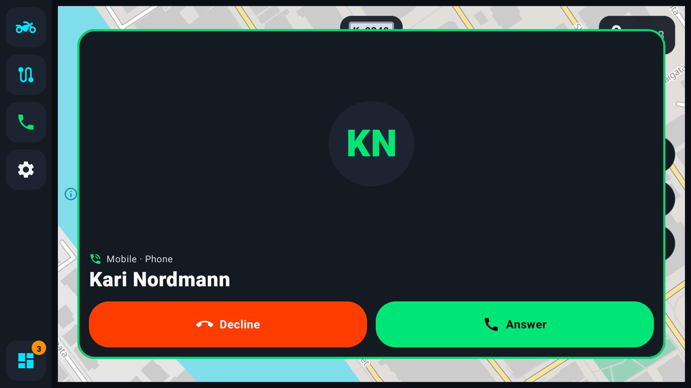

### Make the route your own

Tap *Adjust route* → *Edit on map*: drag the line to make it go through a road you like, drag a
stop to move it, or tap to add a point. Curveon re-routes as you go, and Undo is always there.

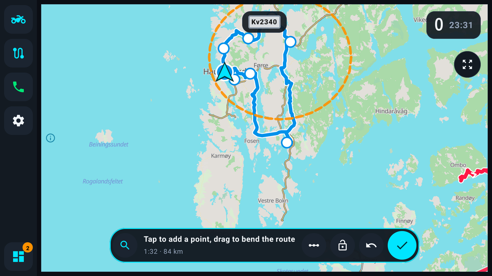

### Roundtrips by drawing

Don't know where to go? Choose *Roundtrip* and circle an area on the map with your finger.
Curveon finds a loop through it that avoids riding the same road twice.

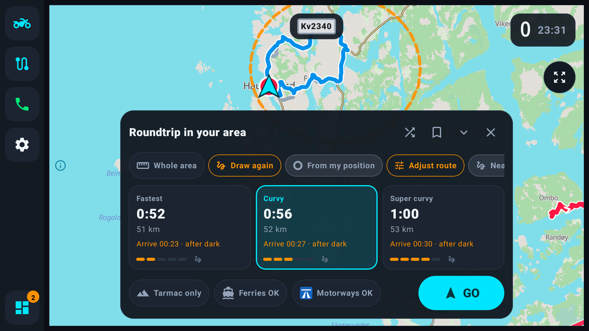

### Save trips for later

Keep the trips you plan under *Planned*, sorted into groups like "Summer tour". Each one opens
with its stops, ready to ride, or to ride the other way round.

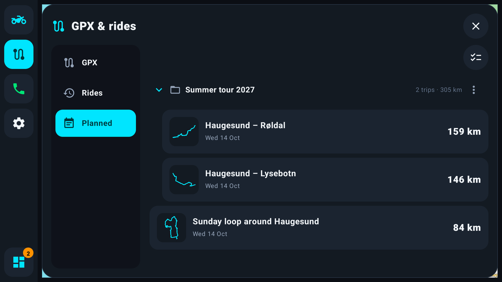

### GPX tracks

Import GPX files from friends, clubs or route planners. Tracks live in groups that you can show,
hide and colour together. Ride any track (also in reverse), and Curveon first guides you to it.
Waypoints such as fuel, camping and viewpoints show as icons on the map.

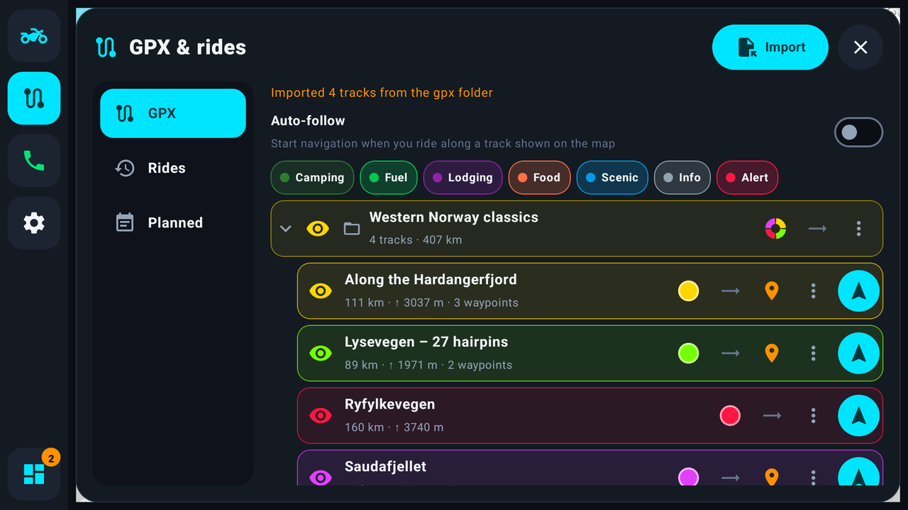

Close to a track you have on the map? Curveon shows how far away it is, and one tap takes you
there and along it.

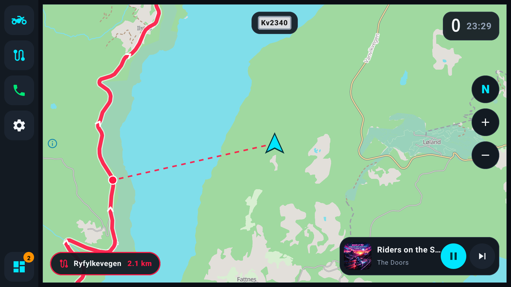

### And a lot more

- **Rides are logged by themselves:** distance, time, speeds and climb. Ride one again, or save it
  as GPX.
- **Stops along the way:** fuel along the route (with a warning before a long gap), or any place
  you pick on the map.
- **Hold a finger on a road** to see its speed limit, number, kind and surface.
- **Tunnels:** your position keeps moving along the route when GPS drops out.
- **Places on the map:** keep fuel, viewpoints, mountain passes, camping, cafés, ferries or
  motorcycle workshops visible all the time.
- **Updates itself:** Curveon tells you when a new version is out and installs it for you.
- **Welcome tour** the first time you start, and a list of every symbol under Settings → Help.

No voice guidance, on purpose: the screen tells you what's next, and your music keeps playing.

---

## On a phone, or a tablet plus your phone

<table>
<tr>
<td width="50%" valign="top">

### Just your phone

Install Curveon on the phone you ride with, and that's it. Messages, calls and music come from
the phone itself (Settings → Phone → *This device*).

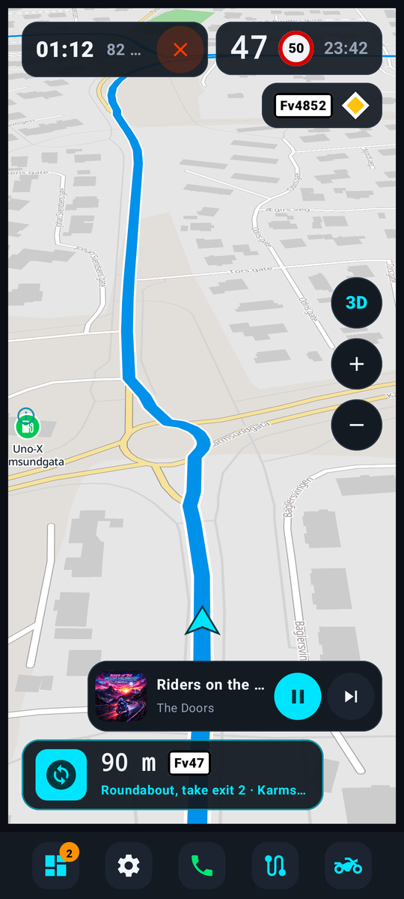

</td>
<td width="50%" valign="top">

### A tablet on the bars + Curveon Companion

A tablet gives you a bigger, brighter screen, while the phone stays in your pocket. Install
**Curveon Companion** on the phone: it sends music, messages and calls to the tablet over
Bluetooth, and lets you reply by voice through your headset.

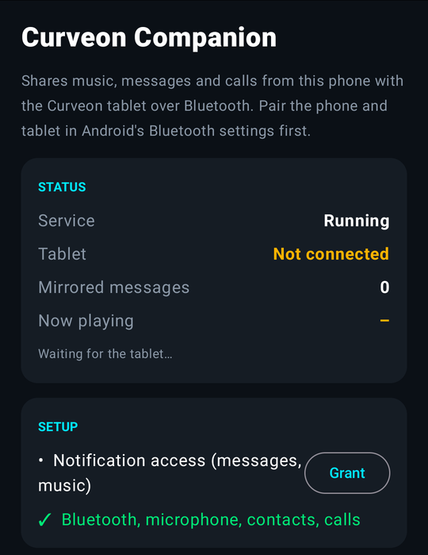

</td>
</tr>
</table>

---

## Get started

1. **Download.** On your phone or tablet, open the
   [**latest release**](https://github.com/atlehavik/curveon/releases/latest) and tap
   **Curveon-x.y.apk** under *Assets*. For a tablet with the phone helper, also download
   **Curveon-Companion-x.y.apk** on the phone.
2. **Install.** Open the downloaded file. Android asks whether your browser may install apps:
   allow it once, then tap *Install*.
3. **Download maps.** In Curveon, go to Settings → *Maps & data* → *Download countries…* while you
   are on Wi-Fi. Each country comes with its map, routing and search.
4. **Ride.** Tap the motorcycle button and search for where you are going.

**Using a tablet with the companion app:** pair the phone and the tablet in Android's Bluetooth
settings. Open Curveon Companion on the phone, allow what it asks for (notifications, Bluetooth,
microphone, contacts) and tap *Start sharing with tablet*. Then, on the tablet: Settings → Phone →
pick your phone.

**Engine data (optional):** plug an ELM327 OBD2 Bluetooth adapter into the bike to see revs,
coolant temperature and battery voltage (Settings → Engine).

---

## Credits

Maps © [OpenStreetMap](https://www.openstreetmap.org/copyright) contributors, via
[Protomaps](https://protomaps.com) and [OpenFreeMap](https://openfreemap.org). Routing by
[BRouter](https://brouter.de). Places also from [Overture Maps](https://overturemaps.org), and in
Norway from Kartverket and Statens vegvesen (speed limits).

Curveon is free and open source under the [MIT License](LICENSE). Third-party components are
listed in [THIRD_PARTY_LICENSES.md](THIRD_PARTY_LICENSES.md).

---

**For developers:** how Curveon is built, how to build it yourself, the data tools and how
releases work are in [docs/DEVELOPMENT.md](docs/DEVELOPMENT.md).
